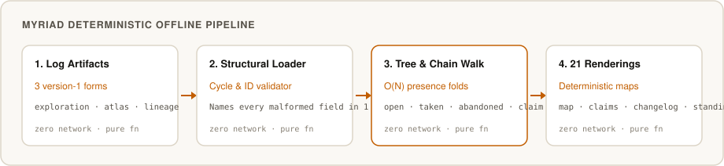

  <picture>
    <source media="(prefers-color-scheme: dark)" srcset="media/myriad-architecture-dark.svg">
    <source media="(prefers-color-scheme: light)" srcset="media/myriad-architecture-light.svg">
    
  </picture>

# Myriad Architecture

Myriad models open-ended multi-agent discovery as immutable snapshots of branching investigation trees (`explorations`), multi-question collections (`atlases`), and temporal sequences of snapshots (`lineages`).

## Four-Stage Pipeline

1. **Version 1 JSON ingestion (`explorations`, `atlas`, `json`).** Depth-guarded parsers validate exploration, atlas, and lineage files, collecting every reachable schema, duplicate-ID, duplicate-open-prompt, missing-parent, or cycle defect before any reading executes.
2. **Forest topology and `dibs` validation (`explorations`, `fork`).** Branch lists are verified in `explorations` as cycle-free forests rooted at `parent` `null`, enforcing state-specific payload rules (`finding` on `taken` branches, `reason` on `abandoned` branches, neither on `open` branches) and tracking optional `claim` ("dibs") ownership labels (`MY-5`), while `fork` builds flat open-root skeletons with duplicate-prompt guards (`MY-4`, `MY-71`).
3. **Snapshot and set readings (`explorations`, `atlas`, `pyprint_table`).** Pure functions project single explorations (`map`, `check`, `claims`, `census`) and multi-question atlases (`atlas`, `index`, `changelog`), computing structural diffs across branches and findings.
4. **Fourteen temporal chain readings (`atlas`).** Over a chronological `lineage` of two or more atlases, deterministic set-algebra passes compute step changelogs, arrivals, departures, returns, absences, contiguous runs, co-occurrence company, identical presence sets, and atlas fellowships.

## Module Map

| Module | Responsibility |
| --- | --- |
| `rust/src/cli.rs` | Command line parser (`-h` / `--help` with `COLUMNS` / `TIOCGWINSZ` help wrapping) and twenty-one subcommand router |
| `rust/src/explorations.rs` | Exploration loader, cycle/parent/prompt validator, and `map`, `check`, `claims`, and `census` renderers |
| `rust/src/fork.rs` | Flat open-root exploration skeleton builder (`fork_skeleton`) with duplicate-prompt detection (`MY-4`, `MY-71`) |
| `rust/src/atlas.rs` | Atlas and lineage loaders plus `atlas`, `index`, `changelog`, `lineage`, and the thirteen chain readings |
| `rust/src/pyprint_table.rs` | Deterministic table alignment helper shared by structured readings |
| `rust/src/json.rs` | Zero-dependency iterative stack-machine JSON parser with `9997` container depth limit and surrogate detection |
| `rust/src/pytext.rs` | Unicode code-unit string type with single-line fencing predicates |
| `rust/src/scan.rs` | Repository codepoint scanner enforcing zero em/en dashes across prose and source files |

## Determinism and Safety Invariants

- **Survey, never a vote or duel.** `myriad` never ranks branches, averages confidence scores, or declares a winning agent. Settled branches (`taken`) and ruled-out branches (`abandoned`) stand side by side on the map so downstream synthesis sees the entire search frontier.
- **Crate vs binary naming.** On crates.io the package is named `myriad-atlas` while the library crate (`use myriad::...`) and CLI binary (`myriad`) keep the `myriad` identifier.
- **Cross-platform parity.** `myriad` compiles and passes its test suite across Linux, macOS, and Windows, gating Unix terminal `ioctl` width queries behind `#[cfg(unix)]` with portable fallbacks everywhere else.
